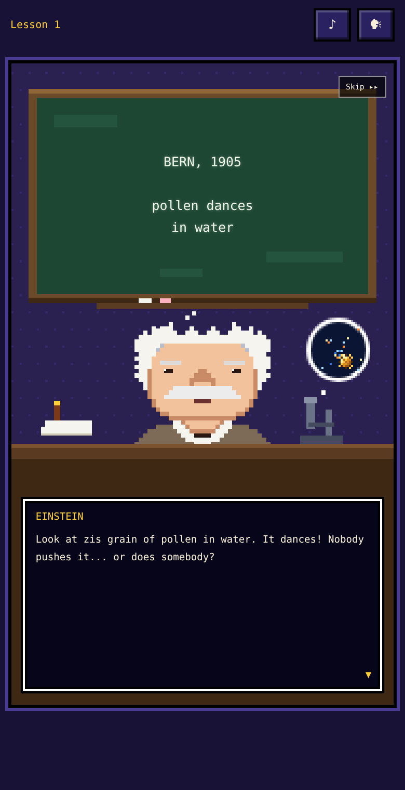
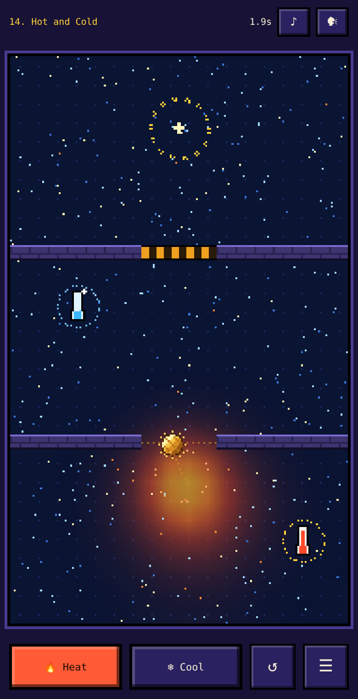

# Brownian!

2D mobile web game themed around Brownian motion, narrated by Albert Einstein.

<div style="display: flex; justify-content: space-between;">
    
    
</div>

**Play it:** https://jdonald.github.io/brownian/

You steer a pollen grain floating in water using only temperature. About 400 simulated water molecules jitter around the grain, and each one moves faster where the water is hotter. Heat pushes the grain away and cold pulls it in. Guide the grain into the golden ring in each of 20 experiments. Between levels, a pixel-art Einstein gives short lessons on Brownian motion, kinetic theory and his 1905 paper, with a soft-spoken German-accented voice.

## How to play

- **Hold your finger** on the water to apply the selected tool.
  - 🔥 **Heat** pushes the grain away from your finger.
  - ❄ **Cool** pulls it toward your finger.
- Settle the grain inside the **golden ring** to finish the level. Faster times earn up to 3 stars.
- **Green glue** is sticky. Touch it and the level restarts.
- **Thermometers** open striped gates. Red ones open when heated and blue ones open when cooled. Some gates need several thermometers at once.
- **Vents** are permanent hot springs or cold sinks that push or pull the grain on their own.
- ↺ restarts the level and ☰ opens the level grid. All 20 levels are unlocked, so you can jump to any of them.
- The **Lessons on/off** switch on the level grid skips the Einstein scenes. **Skip ▸▸** skips a single scene.
- ♪ toggles the music and sound effects. 🗣 opens the voice picker.

### Einstein's voice

The narration uses the browser's built-in speech synthesis, so the voice depends on what your device has installed. The game prefers a German male voice reading English text, with numbers converted to English words. It falls back to an English male voice reading accent-spelled text ("Ve vill vatch zeh vater..."). For the most Einstein-like voice on iPhone, go to Settings → Accessibility → Spoken Content → Voices → German and download **Grandpa**.

## Running locally

The whole game is one self-contained file, `index.html`, with no build step and no dependencies. It loads one font from Google Fonts. Open the file in a browser, or serve the folder:

```sh
python3 -m http.server 8000
# then visit http://localhost:8000
```

## Technical notes

- Plain HTML, CSS and JavaScript in a single file, drawn on a 180×300 pixel canvas that is scaled up with crisp pixels.
- **Temperature field:** an 18×30 grid that diffuses heat and relaxes back toward ambient temperature. Touch adds or removes heat with a Gaussian brush.
- **Molecules:** 420 particles following Langevin dynamics. Each one's thermal speed scales with √T at its position.
- **Grain:** bounced around by elastic collisions with the molecules, plus a thermophoretic drift down the temperature gradient. Cold areas pull harder than hot areas push, so Cool works as a usable "pull".
- **Audio:** the chiptune music, blips and hiss are all synthesized live with the Web Audio API. Speech uses `speechSynthesis`.
- **Saving:** stars and settings are kept in `localStorage`.
- **Playtesting:** a headless Node bot played every level to check that each one can be beaten.

## Development history

The game was built in one conversation with **Claude Opus 5.5** (`claude-opus-5-5`) in the Claude mobile app, in **October 2026**. Each step below was one prompt.

1. **Initial prompt** (quoted in full below): a temperature-steering puzzle with 6 levels, NES/SNES-style Einstein cutscenes with typewriter dialogue, chiptune music and German-voice narration.
2. **Voice fix:** the first version picked up a female German voice and read "1905" in German. Claude added a voice picker that prefers male and old-sounding voices, raised the pitch for a squeaky professor sound, converted numbers to English words, and added accent-spelled text for English voices.
3. **Expansion to 20 levels:** added hot and cold vents, cold-activated thermometers, gates that need several thermometers, and swinging glue. Every level was unlocked behind a 4×5 grid, a Lessons on/off switch was added, and a new Einstein lesson was written for each level. Gates were also retuned, and thermometers now cool slowly.
4. **Archive to GitHub:** this repo, with the README, a `.gitignore` and screenshots.

### Initial prompt

> Make a game to play here in Claude mobile inspired by **Brownian motion**. That is, players manipulate things via the temperature of particles.
>
> In between levels it should have some cute "cinematics" (but more of the classic game animation style nes/snes style not requiring intense 3d rendering) with Einstein giving his lessons/quotes, and with audio with his caricatured German accent soft spoken.

### Follow-up prompts

> Ok, the German-like English writing is great, but the first surprise is that it is a woman's voice, not the characteristic squeaky old man's voice people associate with Albert Einstein. Second, when saying the year 1905 it says the number in German (5 is "funf"), would prefer to have the audio in English with an Einstein-German accent ("five"). Please fix.

> Okay we've beaten the game's 6 levels. Please expand the game to 20 levels in total.
>
> And as we'd hate to fully start over when reopening the Claude app, make it easy to skip and jump to any level from the UI.

## License

MIT. See [LICENSE](LICENSE).
